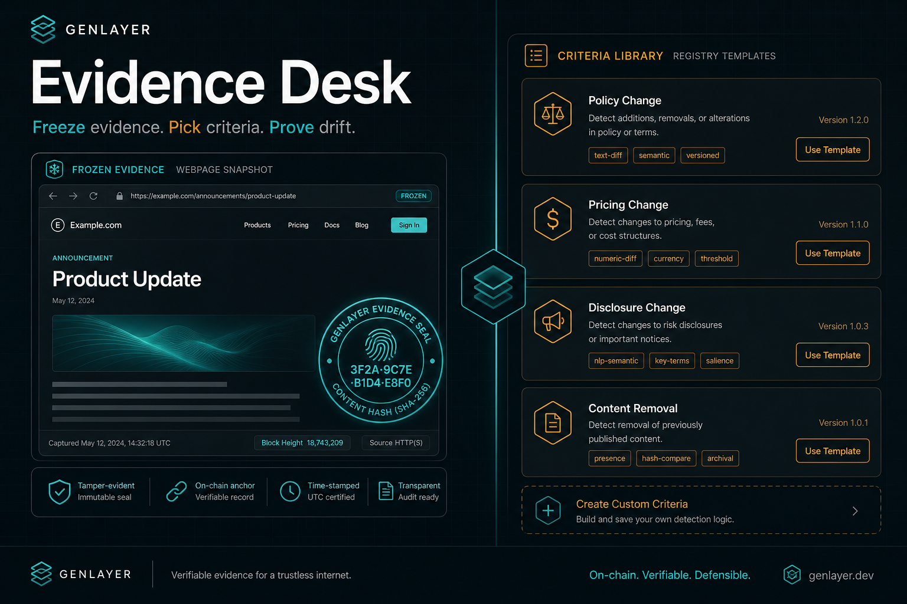

# Evidence Desk

<p align="center">
  
</p>

<p align="center">
  <strong>GenLayer dispute evidence console — freeze evidence, pick criteria, prove drift.</strong>
</p>

<p align="center">
  <a href="https://evidence-desk-chi.valandelon.com"></a>
  <a href="https://docs.genlayer.com/"></a>
  <a href="https://github.com/valentinzubok/EvidenceSnapshot"></a>
  <a href="https://github.com/valentinzubok/PromptRegistry"></a>
</p>

---

## Milestone: EvidenceSnapshot v2 — the drift verdict (Studio Dev 61997)

v1 freezes the pages a dispute cites and tells you the hashes no longer match. v2 answers the next
question: **does the change matter?**

- `open_case(case_id, urls_json, question)` commits the URL set **and the dispute question**, and
  freezes the SHA-256 of each whole normalized document plus a bounded deterministic digest of it.
- `cross_check(case_id)` re-reads those URLs — it accepts none — and records per-URL hash drift.
  Pure arithmetic, no model spend.
- `adjudicate(case_id)` asks validators, for the drifted URLs only, one boolean each: did the
  change alter the answer to the question? `cosmetic_drift` and `material_drift` stop looking the
  same, and an unreadable or unresolvable comparison escalates rather than passing.

| | |
|---|---|
| Contract | [`0xe5a428bC4A6cbd8E61e31C923C9703f5c1bA0047`](https://explorer-studio-dev.genlayer.com/address/0xe5a428bC4A6cbd8E61e31C923C9703f5c1bA0047) on Studio Dev (61997) |
| Source | [`contracts/EvidenceSnapshotV2.py`](contracts/EvidenceSnapshotV2.py), sha256 `c29b70c6…`, checked against the chain by `scripts/verify_evidence_v2.py` in CI |
| Tests | 33, half adversarial — `tests/test_evidence_v2.py`, `tests/test_evidence_v2_adversarial.py` |
| Write-up | [`docs/MILESTONE_EVIDENCE_V2.md`](docs/MILESTONE_EVIDENCE_V2.md) — the v1/v2 table and every transaction |

Hardened to the same standard as the reviewed contracts in this account: literal JSON booleans
only, question and both snapshots fenced as untrusted data with injection phrasing flagged, a
positional `principle` argument (it is positional-only in GenVM v0.3, so the keyword form silently
pushed v1-era contracts onto `strict_eq`), and no consensus fallback — a surprise reverts instead
of resolving a dispute by accident.

## What it is

**Evidence Desk** is a Next.js dApp that unifies two GenLayer primitives into one product workflow:

| Primitive | Role in app |
|-----------|-------------|
| [EvidenceSnapshot](https://github.com/valentinzubok/EvidenceSnapshot) | Open cases, view frozen hashes, run cross_check |
| [PromptRegistry](https://github.com/valentinzubok/PromptRegistry) | Browse top criteria templates, copy get_body text |

GenLayer is central: all reads/writes go through **genlayer-js** on **Studionet** with MetaMask.

**Live demo (read-only works without wallet):** https://evidence-desk-chi.valandelon.com

---

## Features

- **Cases** — list_cases, get_case, open_case, cross_check (wallet)
- **Criteria** — top templates with card previews, get_body, copy to clipboard
- **Wallet** — MetaMask connect + Studionet via `client.connect()`
- **Recent & favorites** — local history for quick case navigation
- **i18n** — English / Ukrainian (UA) UI toggle
- **Explorer links** — Studionet contract pages

---

## Prerequisites

- **Node.js** ≥ 18
- **npm** ≥ 9
- **git**
- **MetaMask** (only for write transactions: `open_case`, `cross_check`)
- Optional: [GenLayer CLI](https://docs.genlayer.com/) if you deploy your own contracts

---

## Getting started

**Full guide:** [docs/quickstart.md](docs/quickstart.md)

```bash
git clone https://github.com/valentinzubok/EvidenceDesk.git
cd EvidenceDesk
npm install
cp .env.example .env.local   # optional — defaults to Studionet addresses
npm run dev
```

Expected output:

```text
▲ Next.js 16.x
- Local:   http://localhost:3000
✓ Ready
```

Open http://localhost:3000

1. Browse **Cases** / **Criteria** without wallet (read-only)
2. Click **Connect Wallet** for transactions
3. Toggle **EN / UA** in the header

### Environment variables

| Variable | Description | Default (Studionet) |
|----------|-------------|---------------------|
| `NEXT_PUBLIC_SNAPSHOT_ADDRESS` | EvidenceSnapshot contract | `0x356C…721a` |
| `NEXT_PUBLIC_REGISTRY_ADDRESS` | PromptRegistry contract | `0xc62e…4DF3` |

Copy from `.env.example`:

```bash
cp .env.example .env.local
```

---

## UI preview

The home hero uses a lightweight CSS/SVG fingerprint animation (no heavy image) — optimized for mobile and desktop.

Screens: **Home** → workflow overview · **Cases** → open_case / cross_check · **Criteria** → template cards + copy

---

## Tests

```bash
npm test          # vitest — JSON parsing, markdown preview, error helpers
npm run lint
npm run build
```

Contract integration tests require Studionet RPC. CI runs lint, test, and build on every push.

---

## Deploy (Vercel)

```bash
npm run build
vercel deploy --prod
```

Set env vars from `.env.example` in Vercel project settings.

Production: https://evidence-desk-chi.valandelon.com

---

## Intelligent Contracts (in this repo)

| Contract | Source | Studionet |
|----------|--------|-----------|
| EvidenceSnapshot | [`contracts/EvidenceSnapshot.py`](contracts/EvidenceSnapshot.py) | `0x356C408058cb82934eE6f62B14FC85D52858721a` |
| PromptRegistry | [`contracts/PromptRegistry.py`](contracts/PromptRegistry.py) | `0xc62eC7D0133867b33f50D7E9416D01A8Cc244DF3` |

App ↔ method map: [`contracts/README.md`](contracts/README.md) · bindings: [`src/lib/contracts.ts`](src/lib/contracts.ts)

---

## Stack

- Next.js 16 (App Router) + TypeScript + Tailwind
- [genlayer-js](https://github.com/genlayerlabs/genlayer-js) (Studionet)
- MetaMask (`window.ethereum`)
- Vitest for unit tests
- CSP + security headers in `next.config.ts`

---

## Portal

Submit under **Projects** — see [SUBMIT.md](SUBMIT.md).

## Docs

- [Quickstart](docs/quickstart.md) — step-by-step local setup & troubleshooting
- [Criteria templates](docs/templates.md) — examples & card previews
- [Architecture](docs/ARCHITECTURE.md) — stack & design decisions
- [Roadmap](docs/ROADMAP.md) — factory, GraphQL, RBAC (planned)
- [OpenAPI](docs/openapi.yaml) — contract surface for integrators
- [Contributing](CONTRIBUTING.md) · [Security](SECURITY.md)

## API routes

| Route | Description |
|-------|-------------|
| `GET /api/cases` | On-chain case IDs |
| `GET /api/history?ids=a,b` | Validate client favorites/recent against chain |

---

## License

MIT © Valentyn Zubok
